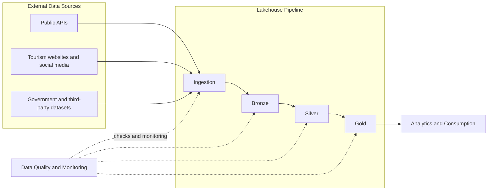

# Architecture Overview

The following is a high-level overview of the architecture of the Japan Tourism Lakehouse project. It outlines the key components, their interactions, and the overall design principles that guide the development and deployment of the system.

## Project purpose and business objectives

The Japan Tourism Lakehouse project aims to create a comprehensive data solution that enables effective analysis and insights into tourism trends and patterns in Japan. The business objectives include:

- Enhancing decision-making capabilities for tourism stakeholders.
- Providing a scalable and flexible data architecture that can accommodate future growth and changes in data sources.
- Ensuring data quality, integrity, and security throughout the data lifecycle.
- Facilitating advanced analytics and machine learning applications to derive actionable insights from tourism data.

## High-level architecture

The solution is designed as a multi-layered architecture that separates data ingestion, storage, processing, and presentation. The key components include:

- **Bronze Layer**: Responsible for collecting raw data from various sources, including APIs, web scraping, and third-party datasets. This layer ensures that data is ingested in an append-only manner, preserving the original source records for historical traceability.
- **Silver Layer**: Implements data cleaning, validation, and standardization processes to ensure data quality and consistency. This layer serves as an intermediary between the bronze layer and the gold layer.
- **Gold Layer**: Contains curated, transformed, and enriched data that is ready for analysis and reporting. This layer provides a unified view of the data for different business use cases.
- **Analytics and Consumption**: Provides visualization and reporting capabilities, enabling stakeholders to access and interpret the data through dashboards, reports, and other analytical tools.
- **Data Quality and Monitoring**: Implements automated data quality checks, monitoring, and alerting mechanisms to ensure the integrity and reliability of the data throughout the processing pipeline.
- **Data Governance and Security**: Ensures that data access, privacy, and compliance requirements are met throughout the data lifecycle. This includes implementing role-based access controls, data encryption, and auditing mechanisms.

## Data sources

The architecture supports a variety of data sources, including:

- Public APIs providing tourism-related data.
- Web scraping of tourism websites and social media platforms.
- Third-party datasets from government and private organizations.

## Data processing layers

The architecture is designed to support independent transformation layers, allowing for flexible and modular data processing. Each layer can be developed, tested, and deployed independently, enabling rapid iteration and adaptation to changing business requirements. The architecture is based on the Medallion Architecture, which promotes separation of concerns and enhances maintainability.

## Source changes and historical data assumptions

- **Source deletions**: Retain the original records in the bronze layer. Mark a record deleted or inactive in the consolidated representation only when the source provides an explicit deletion signal or a confirmed complete snapshot omits it. Absence from an incremental feed alone does not imply deletion.
- **Historical republishes**: Record the source, extraction time, and batch or snapshot identifier for each ingestion. Use stable source identifiers to make reprocessing and full historical republishes idempotent rather than creating duplicate current records. Reconcile omissions only after confirming a snapshot is complete.
- **Corrections versus new historical versions**: Prefer source version identifiers, update timestamps, and effective dates to identify corrections and distinct historical versions. If the source lacks sufficient metadata, preserve each observed state and its ingestion lineage; treat the latest valid state as current without inferring that a correction is a new historical version.

## Python application structure

The Python application is structured to support the various components of the architecture, including data ingestion, processing, and analytics. The application is organized into modules that correspond to the different layers of the architecture, with clear interfaces and dependencies between them. This modular design allows for easy maintenance, testing, and deployment of individual components.

## Data quality and testing strategy

Testing is an integral part of the architecture, ensuring that data quality and integrity are maintained throughout the processing pipeline. The testing strategy includes:

- Unit tests for individual components and functions.
- Integration tests to validate the interactions between different layers and components.
- End-to-end tests to ensure that the entire data processing pipeline functions as expected.

## Technology stack

The architecture leverages a modern technology stack that includes:

- Data storage and processing: Databricks, Delta Lake, and Apache Spark for scalable and efficient data processing.
- Data visualization and reporting: Databricks AI/BI tools for creating interactive dashboards and reports.

## Security and operational considerations

The architecture incorporates security and operational best practices to ensure the confidentiality, integrity, and availability of the data. This includes implementing access controls, encryption, monitoring, and alerting mechanisms to detect and respond to potential security threats or operational issues.
